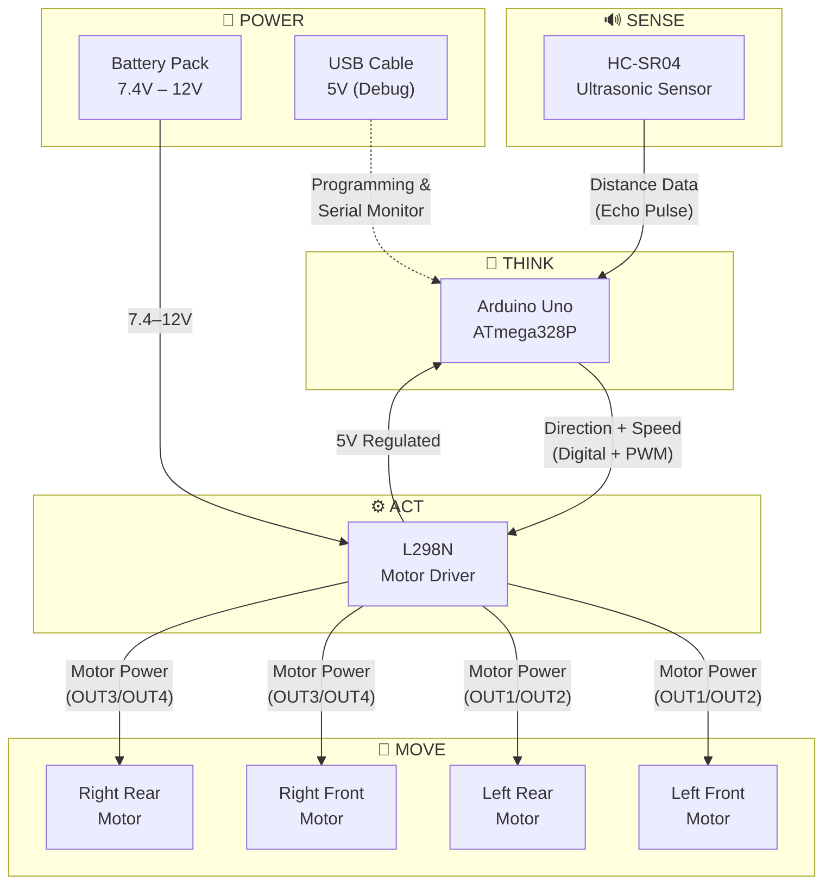
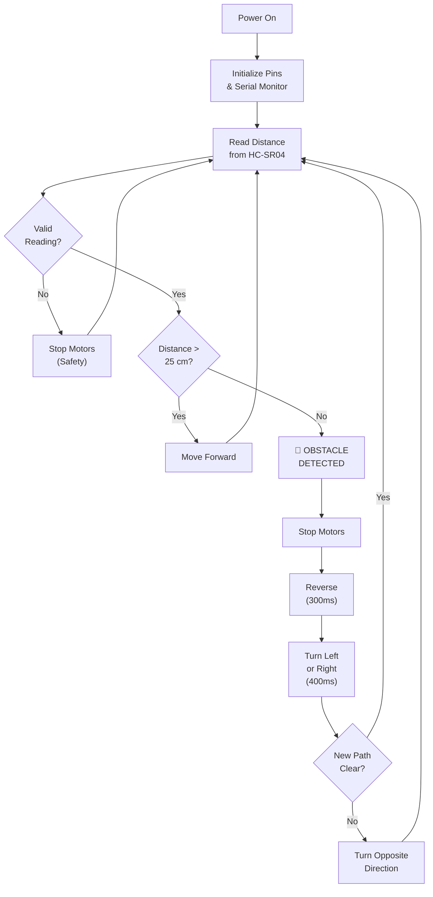

# 🤖 Obstacle-Avoiding Robot Car

[](LICENSE)
[](https://www.arduino.cc/)
[](#reconstruction-notice)

An autonomous four-wheel robot car that detects obstacles using an HC-SR04 ultrasonic sensor and automatically avoids collisions, powered by an Arduino Uno and L298N motor driver.

> **📸 Prototype photographs will be added once the hardware is reassembled and photographed.**

---

## 📋 Table of Contents

- [Reconstruction Notice](#reconstruction-notice)
- [Project Description](#project-description)
- [Objectives](#objectives)
- [Features](#features)
- [System Architecture](#system-architecture)
- [Hardware Components](#hardware-components)
- [Software Requirements](#software-requirements)
- [Working Principle](#working-principle)
- [Circuit Connections](#circuit-connections)
- [Installation](#installation)
- [How to Upload Code](#how-to-upload-code)
- [How to Operate](#how-to-operate)
- [Testing Status](#testing-status)
- [Project Structure](#project-structure)
- [Future Enhancements](#future-enhancements)
- [Author](#author)
- [License](#license)

---

## ⚠️ Reconstruction Notice

> **Important:** This project was originally completed during the author's **first year of college**.
> The original source code, photographs, circuit diagrams, and documentation are **no longer available**.
>
> This repository has been **reconstructed in 2026** for academic documentation and portfolio purposes.
>
> - ✅ Code has been rewritten to faithfully recreate the original functionality
> - ✅ Documentation has been created from scratch with professional standards
> - ❌ Original prototype photographs are not available
> - ❌ Hardware testing has NOT been completed — all tests are marked as NOT TESTED
> - ❌ No test results have been fabricated

---

## 📖 Project Description

The **Obstacle-Avoiding Robot Car** is an embedded systems project that demonstrates autonomous navigation using basic sensor-actuator feedback. The robot continuously measures the distance to objects in its path using an ultrasonic sensor and makes real-time decisions to navigate around obstacles without human intervention.

This project covers fundamental concepts in:
- **Embedded Systems** — Microcontroller programming and hardware interfacing
- **Robotics** — Autonomous movement and sensor-based decision making
- **Electronics** — Motor drivers, sensors, and power distribution
- **Control Systems** — Feedback loops and reactive behavior

---

## 🎯 Objectives

1. Design and build an autonomous four-wheel robot car
2. Integrate an HC-SR04 ultrasonic sensor for distance measurement
3. Control four DC motors using an L298N dual H-bridge motor driver
4. Implement obstacle detection with a configurable distance threshold
5. Execute safe avoidance maneuvers (stop → reverse → turn → resume)
6. Provide serial debugging output for monitoring and troubleshooting
7. Create comprehensive, beginner-friendly documentation

---

## ✨ Features

| Feature | Description |
|---------|-------------|
| 🔊 Ultrasonic Sensing | HC-SR04 measures distance to obstacles (2–400 cm range) |
| 🚗 Four-Wheel Drive | Four DC geared motors for stable, balanced movement |
| ⚡ PWM Speed Control | Configurable motor speed via pulse-width modulation |
| 🔄 Smart Avoidance | Alternating left/right turns to avoid getting stuck in corners |
| 🛡️ Safety Handling | Invalid sensor readings trigger an immediate safety stop |
| 📊 Serial Debugging | Real-time distance readings and action logs via serial monitor |
| 🔧 Configurable | Easy-to-adjust threshold, speed, and timing parameters |
| 📝 Well-Documented | Comprehensive documentation for learning and interviews |

---

## 🏗️ System Architecture



### Decision Flow



---

## 🔧 Hardware Components

| # | Component | Quantity | Purpose |
|---|-----------|----------|---------|
| 1 | Arduino Uno R3 | 1 | Microcontroller — runs the program |
| 2 | HC-SR04 Ultrasonic Sensor | 1 | Measures distance to obstacles |
| 3 | L298N Motor Driver Module | 1 | Controls motor speed and direction |
| 4 | DC Geared Motor (3–6V) | 4 | Drives the wheels |
| 5 | Four-Wheel Robot Chassis | 1 | Structural frame |
| 6 | Robot Wheels (65mm) | 4 | Locomotion |
| 7 | Jumper Wires | ~20 | Electrical connections |
| 8 | Battery Pack (7.4V Li-ion) | 1 | Power supply for motors |
| 9 | USB Cable (Type-A to B) | 1 | Programming and debugging |

> 📋 Detailed specifications: [`docs/hardware_requirements.md`](docs/hardware_requirements.md)

---

## 💻 Software Requirements

| Software | Version | Purpose |
|----------|---------|---------|
| Arduino IDE | 2.0+ | Code editor, compiler, uploader |
| USB Driver | Latest | CH340/CP2102 (for clone boards) |

**No external libraries required** — the project uses only built-in Arduino functions.

> 📋 Detailed setup: [`docs/software_requirements.md`](docs/software_requirements.md)

---

## ⚙️ Working Principle

The robot operates on a continuous **Sense → Think → Act** loop:

1. **Sense:** The HC-SR04 ultrasonic sensor emits a 40kHz pulse and measures the time for the echo to return. Distance is calculated using the formula:

   ```
   Distance (cm) = Echo Duration (µs) / 58
   ```

2. **Think:** The Arduino compares the measured distance against a configurable threshold (default: 25 cm) and decides the appropriate action.

3. **Act:** The L298N motor driver translates Arduino commands into motor movements:
   - **Path clear** → Move forward
   - **Obstacle detected** → Stop → Reverse → Turn → Resume

> 📋 Full explanation: [`docs/working_principle.md`](docs/working_principle.md)

---

## 🔌 Circuit Connections

### Quick Reference

| Connection | From | To |
|-----------|------|-----|
| Sensor Trigger | Arduino Pin 9 | HC-SR04 TRIG |
| Sensor Echo | Arduino Pin 10 | HC-SR04 ECHO |
| Sensor Power | Arduino 5V | HC-SR04 VCC |
| Left Motor Speed | Arduino Pin 5 (PWM) | L298N ENA |
| Left Motor Dir. | Arduino Pins 2, 3 | L298N IN1, IN2 |
| Right Motor Speed | Arduino Pin 6 (PWM) | L298N ENB |
| Right Motor Dir. | Arduino Pins 4, 7 | L298N IN3, IN4 |
| Motor Power | Battery 7.4V+ | L298N 12V Terminal |
| Common Ground | Arduino GND | L298N GND |

> ⚠️ **Never connect motors directly to Arduino pins.** Always use a motor driver.

> 📋 Full wiring guide: [`circuit/wiring_guide.md`](circuit/wiring_guide.md)  
> 📋 Pin configuration: [`circuit/pin_configuration.md`](circuit/pin_configuration.md)

---

## 📥 Installation

### Quick Start

```bash
# 1. Clone the repository
git clone https://github.com/YOUR-USERNAME/Obstacle-Avoiding-Robot.git

# 2. Open the Arduino sketch
#    Navigate to code/obstacle_avoiding_robot/ and open obstacle_avoiding_robot.ino in Arduino IDE

# 3. Select Board and Port
#    Tools → Board → Arduino Uno
#    Tools → Port → COMx (your Arduino's port)

# 4. Upload
#    Click the Upload button (→)
```

> 📋 Detailed guide: [`docs/installation_guide.md`](docs/installation_guide.md)

---

## 📤 How to Upload Code

1. Connect Arduino Uno to your computer via USB
2. Open `code/obstacle_avoiding_robot/obstacle_avoiding_robot.ino` in Arduino IDE
3. Select **Tools → Board → Arduino Uno**
4. Select **Tools → Port → COMx** (your Arduino's COM port)
5. Click **Verify** (✓) to compile — should complete without errors
6. Click **Upload** (→) to transfer the code to the Arduino
7. Open **Serial Monitor** (🔍) at **9600 baud** to verify initialization

---

## 🎮 How to Operate

1. **Assemble** the robot following the [Wiring Guide](circuit/wiring_guide.md)
2. **Upload** the code to the Arduino (see above)
3. **Place** the robot on a flat surface with clear space around it
4. **Connect** the battery pack
5. **Power on** — the robot starts automatically
6. **Observe:**
   - Robot moves forward when path is clear
   - Robot stops and avoids when an obstacle is within 25 cm
   - Serial monitor displays real-time distance and action logs

### Adjustable Parameters

Edit these values in the code to customize behavior:

| Parameter | Default | Description |
|-----------|---------|-------------|
| `OBSTACLE_THRESHOLD_CM` | 25 | Distance (cm) to trigger avoidance |
| `MOTOR_SPEED` | 180 | Forward speed (0–255) |
| `TURN_SPEED` | 200 | Turning speed (0–255) |
| `TURN_DURATION_MS` | 400 | How long to turn (ms) |
| `BACKUP_DURATION_MS` | 300 | How long to reverse (ms) |

---

## 🧪 Testing Status

> **⚠️ Hardware testing has NOT been completed.**
> All 38 test cases are currently marked as **NOT TESTED**.

| Category | Tests | Status |
|----------|-------|--------|
| Hardware Verification | 4 | ⏳ Not Tested |
| Ultrasonic Sensor | 7 | ⏳ Not Tested |
| Motor Direction | 6 | ⏳ Not Tested |
| Speed Control | 3 | ⏳ Not Tested |
| Obstacle Avoidance | 6 | ⏳ Not Tested |
| Emergency/Edge Cases | 4 | ⏳ Not Tested |
| Serial Monitor | 4 | ⏳ Not Tested |
| Power/Battery | 4 | ⏳ Not Tested |

> 📋 Full test plan: [`testing/test_plan.md`](testing/test_plan.md)

---

## 📁 Project Structure

```
Obstacle-Avoiding-Robot/
│
├── README.md                          # Project overview (this file)
├── LICENSE                            # MIT License
├── .gitignore                         # Git ignore rules
├── CONTRIBUTING.md                    # Contribution guidelines
├── CHANGELOG.md                       # Version history
│
├── code/
│   └── obstacle_avoiding_robot/
│       └── obstacle_avoiding_robot.ino  # Arduino source code
│
├── circuit/
│   ├── wiring_guide.md                # Complete wiring instructions
│   ├── pin_configuration.md           # Pin mapping tables
│   └── circuit_diagram_placeholder.md # Diagram creation guide
│
├── docs/
│   ├── project_overview.md            # Detailed project description
│   ├── working_principle.md           # Engineering concepts explained
│   ├── hardware_requirements.md       # Component specifications
│   ├── software_requirements.md       # IDE and setup requirements
│   ├── installation_guide.md          # Step-by-step setup
│   ├── troubleshooting.md             # Common issues and fixes
│   └── future_improvements.md         # Planned enhancements
│
├── testing/
│   └── test_plan.md                   # 38 structured test cases
│
└── images/
    └── README.md                      # Image directory guide
```

---

## 🚀 Future Enhancements

| Enhancement | Difficulty | Impact |
|------------|-----------|--------|
| Servo-mounted sensor scanning | Beginner | High |
| Bluetooth remote control | Intermediate | High |
| IR proximity sensors | Beginner | Medium |
| OLED display dashboard | Intermediate | Medium |
| Wheel encoder odometry | Intermediate | High |
| WiFi monitoring (ESP32) | Advanced | Medium |

> 📋 Full roadmap: [`docs/future_improvements.md`](docs/future_improvements.md)

---

## 👤 Author

| Field | Details |
|-------|---------|
| **Name** | [Your Name] |
| **Project** | Academic — First-Year College Project (Reconstructed 2026) |
| **Category** | Embedded Systems / Robotics / Arduino |
| **Contact** | [Your Email] |
| **GitHub** | [Your GitHub Profile] |

---

## 📄 License

This project is licensed under the **MIT License** — see the [LICENSE](LICENSE) file for details.

---

<p align="center">
  <b>⭐ If you found this project helpful, please consider giving it a star! ⭐</b>
</p>
